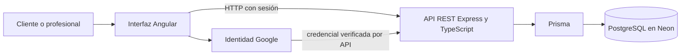
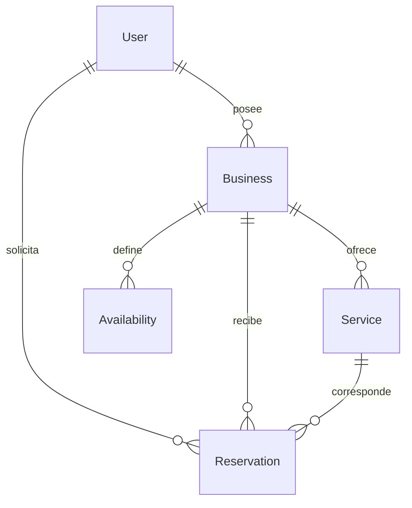

# Diseño inicial y trazabilidad de CRONOS

Actualización documental del 5 de noviembre de 2026. Base de contraste: `3c68c0d`.
Respalda el diseño de la ficha 01 y la reconstrucción de la ficha 03. Describe el
alcance inicial y lo contrasta con la implementación disponible; no atribuye todos
los módulos actuales a septiembre ni acredita aprobación docente.

## 1 Alcance y actores

El cliente consulta la oferta y solicita reservas. El profesional propietario
administra su negocio, servicios, disponibilidad y agenda. El incremento inicial
prioriza ese recorrido. Los pagos reales y notificaciones no son resultados de la
ficha 01. Superadministración, categorías, galerías e historial son ampliaciones
del sistema y no alteran retroactivamente el alcance del diseño inicial.

## 2 Arquitectura

Angular presenta formularios, navegación y resultados. Express valida identidad,
rol, propiedad y reglas de negocio. Prisma relaciona entidades y ejecuta consultas
y transacciones. PostgreSQL conserva los datos. La configuración sensible se
mantiene fuera del repositorio. La guardia del navegador no sustituye permisos de API.

Evidencias: [rutas Angular](../../../../frontend/src/app/app.routes.ts),
[servidor API](../../../../backend/src/server.ts),
[autorización](../../../../backend/src/middleware/auth.middleware.ts),
[esquema Prisma](../../../../backend/prisma/schema.prisma) y
[migraciones](../../../../backend/prisma/migrations).

## 3 Modelo de datos base

| Entidad | Datos principales | Relación y regla |
| --- | --- | --- |
| User | id, email, name, role | Identifica al cliente o propietario; el rol controla operaciones. |
| Business | id, ownerId, name, timezone | Cada negocio tiene un propietario y separa su oferta y agenda. |
| Service | id, businessId, name, durationMin, price, isActive | Cada servicio pertenece a un negocio; duración y precio se validan. |
| Availability | id, businessId, dayOfWeek, startTime, endTime | Define horarios del negocio; no es una reserva de un cliente. |
| Reservation | id, businessId, serviceId, clientId, startsAt, endsAt, status | Relaciona cliente, servicio y negocio en un intervalo y estado. |

Las cardinalidades permiten varios negocios por propietario. No existe una clave
foránea de Reservation hacia Availability: la API valida el intervalo contra los
horarios y las reservas activas. En el sistema posterior, ClientSession añade una
atención única por reserva; sus imágenes se relacionan mediante SessionEvidence.

## 4 Flujo y navegación

1. El profesional autenticado configura su negocio, servicios y disponibilidad.
2. El cliente descubre un negocio y selecciona un servicio activo.
3. El cliente inicia sesión antes de acceder a la consulta de horarios protegida.
4. La interfaz solicita intervalos para la fecha y el negocio seleccionados.
5. Al confirmar, la API vuelve a comprobar identidad, servicio, fecha y horario.
6. La API registra la reserva si no existe solapamiento y devuelve el resultado.
7. Cliente y propietario consultan sus listados; cancelar o completar respeta estados.

Pantallas: `login`, `business/:id`, `booking/:serviceId`, `my-reservations`,
`dashboard`, `dashboard/services` y `dashboard/availability`. El
[diagrama de actividades del equipo](../Diagramas%20de%20actividades/Cronos_Diagrama_Actividadesv2.drawio.png)
es una evidencia posterior; la ficha 05 documenta las diferencias de su secuencia
de acceso respecto de las guardias actuales.

## 5 Backlog inicial priorizado

Este backlog organiza el diseño; sus criterios no equivalen a aceptación ya ejecutada.

| Prioridad | Historia | Criterio de aceptación | Implementación de referencia |
| --- | --- | --- | --- |
| Alta | Como usuario, quiero identificarme. | La sesión permite operaciones del rol correcto y rechaza accesos sin permiso. | auth.controller.ts; guardias Angular. |
| Alta | Como profesional, quiero publicar mi negocio. | El perfil queda asociado al propietario autenticado. | business.controller.ts. |
| Alta | Como profesional, quiero crear servicios. | Nombre, duración y precio se validan y el servicio pertenece a mi negocio. | service.controller.ts; ficha 02. |
| Alta | Como profesional, quiero definir horarios. | La disponibilidad corresponde a mi negocio y permite consultar intervalos. | availability.controller.ts. |
| Alta | Como cliente, quiero reservar un intervalo. | Servicio activo, fecha futura y ausencia de solapamiento; confirmación persistida. | reservation.controller.ts. |
| Media | Como usuario, quiero consultar y cancelar mis reservas. | Solo registros propios y transiciones permitidas, sin cancelar atenciones completadas. | reservation.routes.ts; reservation-state.ts. |

## 6 Reconstrucción de la iteración 03

La ficha 02 aborda el primer proceso conectado de servicios. Esta reconstrucción
relaciona ese antecedente con reservas, permisos y estados. La ficha 04 conserva
el inventario y sus pesos; esta reconstrucción no modifica su 50 % de avance reconocido.

| Componente | Evidencia de implementación | Alcance de la comprobación |
| --- | --- | --- |
| Consulta de horarios | [availability.routes.ts](../../../../backend/src/routes/availability.routes.ts) | Exige sesión y rol CLIENT en /slots. |
| Crear y consultar reserva | [reservation.controller.ts](../../../../backend/src/controllers/reservation.controller.ts) | Valida datos, rol, servicio, fecha, disponibilidad y solapamiento. |
| Permisos de reserva | [reservation.routes.ts](../../../../backend/src/routes/reservation.routes.ts) | Sesión y roles en la API, además de propiedad comprobada en controladores. |
| Cancelar y completar | [reservation-state.ts](../../../../backend/src/lib/reservation-state.ts) | Actualizaciones condicionales e idempotencia; no permite cancelar una atención completada. |
| Atención única | [schema.prisma](../../../../backend/prisma/schema.prisma) | ClientSession.reservationId es único. |
| Verificación unitaria | [registro de ejecución](verificacion-reservas-2026-11-05.md) | Cinco pruebas aprobadas el 5 de noviembre; transacciones simuladas. |

| Caso integrado por registrar | Resultado esperado | Estado |
| --- | --- | --- |
| Reserva válida desde Angular | HTTP 201, una reserva persistida y visible para cliente y profesional. | Pendiente de demostración integrada. |
| Intervalo ocupado | Conflicto de disponibilidad, sin una reserva activa adicional. | Pendiente de demostración integrada. |
| Dos clientes reservan simultáneamente | Una confirmación y un conflicto; sin solapamiento activo en la base. | Pendiente de concurrencia real en desarrollo. |
| Consulta o cambio de registro ajeno | Operación denegada sin modificar datos. | Pendiente de recorrido integrado por roles. |

La validación real debe registrar versión, fecha, datos de prueba sin información
privada, resultado esperado, resultado observado y evidencia. No se adjuntan firmas
ni aprobación docente a esta reconstrucción.
